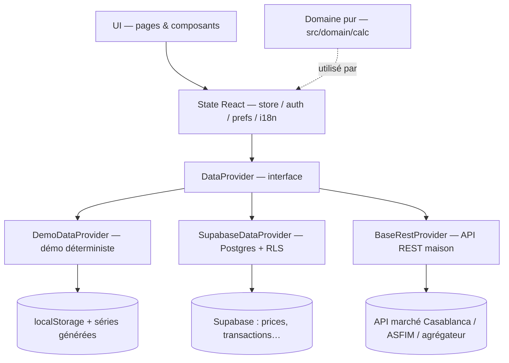

# Architecture — Patrimoine.ma

Document de référence pour comprendre l'organisation de l'application et l'ajout de
nouvelles fonctionnalités. Tous les chemins sont relatifs à la racine du projet.

---

## 1. Vue en couches

L'application suit une architecture en couches strictement séparées, du plus stable au plus
volatile. Le **domaine ne dépend de rien** (pur TypeScript) ; l'UI ne dépend jamais
directement d'une source de données, uniquement du **store**, qui lui-même parle à un
**DataProvider** abstrait.

```text
┌────────────────────────────────────────────────────────────────────┐
│  UI  (src/pages, src/components)                                   │
│  React 19 · React Router 7 · Tailwind v4 · Recharts · Radix       │
│  Consomme : useStore() / useI18n() / usePreferences() / useAuth() │
└───────────────▲────────────────────────────────────────────────────┘
                │ props / hooks (aucun accès direct aux données)
┌───────────────┴────────────────────────────────────────────────────┐
│  STATE  (src/state)                                                │
│  StoreProvider  : chargement, sélecteurs dérivés, mutations        │
│  AuthProvider   : session utilisateur                             │
│  Preferences    : thème clair/sombre, masque des montants         │
│  I18nProvider   : locale fr/en/ar, RTL, t()                       │
└───────────────▲────────────────────────────────────────────────────┘
                │ promesses (DataProvider)
┌───────────────┴────────────────────────────────────────────────────┐
│  DATA  (src/data/provider)                                        │
│  interface DataProvider (types.ts)                                │
│  ├── DemoDataProvider   (demo.ts)   ← défaut, localStorage        │
│  ├── SupabaseDataProvider (supabase.ts) ← Postgres + RLS          │
│  └── BaseRestProvider   (index.ts)  ← gabarit API REST maison     │
│  Fabrique : createDataProvider() / getProvider() / setProvider()  │
└───────────────▲────────────────────────────────────────────────────┘
                │
┌───────────────┴────────────────────────────────────────────────────┐
│  SOURCES                                                           │
│  • Jeu de démo déterministe (src/data/demo/*)                     │
│  • Supabase (Postgres + Auth + RLS, docs/supabase-schema.sql)     │
│  • API marché : Bourse de Casablanca, ASFIM / sociétés de         │
│    gestion, agrégateurs (cours différés, licence de diffusion)    │
└────────────────────────────────────────────────────────────────────┘

┌────────────────────────────────────────────────────────────────────┐
│  DOMAIN  (src/domain) — pur, sans dépendance UI/réseau            │
│  types.ts  : modèle de données (Instrument, Transaction, Quote…)  │
│  calc/*    : PRU/positions · TWR · XIRR · risque · fiscalité ·    │
│              allocation + tests *.test.ts                         │
└────────────────────────────────────────────────────────────────────┘
```

Équivalent Mermaid :



Ordre d'emboîtement des providers React (`src/App.tsx`) :

```text
<I18nProvider>                     ← langue + RTL, impacte tout l'arbre
  <PreferencesProvider>            ← thème + masque, persistés localement
    <ToastProvider>                ← toasts globaux
      <AuthProvider>               ← session (OTP simulé en démo)
        <TooltipProvider>
          <BrowserRouter>
            <RequireAuth>          ← redirection /login si non authentifié
              <StoreProvider>      ← données métier (appelé dans la zone protégée)
                <AppShell />       ← layout + <Outlet/> des pages
```

---

## 2. Flux de données — exemple du tableau de bord

1. **Chargement** : `StoreProvider` (`src/state/store.tsx`) déclenche au montage (et à
   chaque bump de `version`) un `Promise.all` de **10 appels provider** :
   `listPortfolios`, `listInstruments`, `getQuotes`, `getIndexQuotes`,
   `listCorporateEvents`, `listWatchlist`, `listAlerts`, `listAllTransactions`,
   `getUser`, `getPriceHistories`. L'état brut (`StoreState`) est stocké dans un
   `useState` ; `loading` / `refreshing` / `error` pilotent les squelettes et messages.
2. **Réduction domaine** : les sélecteurs dérivés (mémoïsés) transforment l'état brut :
   - `snapshotOf(portfolioId)` → `buildSnapshot({ transactions, instruments, quotes })`
     (`src/domain/calc/positions.ts`) : positions, PRU, plus-values, trésorerie.
     Pour l'agrégat « Tous les portefeuilles », `mergeSnapshots` fusionne les snapshots.
   - `seriesOf(range)` → `buildValueSeries({ transactions, priceHistory })`
     (`src/domain/calc/performance.ts`) : valorisation jour par jour, TWR cumulé.
   - `performanceOf(range)` → `computePerformance(...)` : TWR, XIRR, rendement simple.
3. **Rendu** : les pages n'appellent que des sélecteurs et du calcul domaine restant :
   - `src/pages/DashboardPage.tsx` : bandeau indices (`indices`), carte principale
     (`snapshot.totalValue`, variation du jour), donut `buildAllocation(positions, cash)`,
     courbe `seriesOf(range)`, comparaison MASI via `rebase(indexHistory, dates)`,
     creux `drawdownSeries`.
4. **Mutations** (saisie d'une opération, alerte, mise à jour de cours…) : la page appelle
   une fonction du store (`saveTransaction`, `saveAlert`, `updatePrice`, …) → appel
   `provider.saveX(...)` → `withReload()` incrémente `version`, ce qui relance l'étape 1.
   En mode démo, l'état modifié est persisté dans `localStorage` (préfixe
   `patrimoine.ma/v1/`) et survit au rechargement ; `resetDemo()` restaure les seeds.

```mermaid
sequenceDiagram
    participant P as Page (DashboardPage)
    participant S as StoreProvider
    participant D as DataProvider
    participant C as Domaine (calc)
    P->>S: useStore() → snapshot, indices, series
    S->>D: Promise.all(10 méthodes)
    D-->>S: données brutes
    S->>C: buildSnapshot / buildValueSeries / computePerformance
    C-->>sélecteurs dérivés (useMemo)
    S-->>P: snapshot / performanceOf / seriesOf
```

---

## 3. Contrat `DataProvider`

Défini dans `src/data/provider/types.ts`, implémenté par :

| Implémentation | Fichier | Rôle |
| --- | --- | --- |
| `DemoDataProvider` | `src/data/provider/demo.ts` | Jeu de démonstration déterministe (séries générées par PRNG à graine, `src/data/demo/*`), état persisté en `localStorage`, **latence simulée** (120–260 ms) pour matérialiser les squelettes de chargement. |
| `SupabaseDataProvider` | `src/data/provider/supabase.ts` | Postgres + RLS. Reçoit un client « compatible Supabase » (`SupabaseLike`) injecté par le appelant : aucune dépendance compile-time à `@supabase/supabase-js`. Lit `v_latest_quotes` pour les cours, `prices` pour l'historique, `set_manual_price` pour les saisies manuelles. |
| `BaseRestProvider` (abstraite) | `src/data/provider/index.ts` | Gabarit d'adaptateur REST : `get<T>()` avec `baseUrl` + `Authorization: Bearer`, méthodes `abstract` à implémenter 1:1 avec `GET /instruments`, `/prices`, `/quotes`, `/indices`, `/navs`, `/events`. |

Caractéristiques communes :

- **Toutes les méthodes retournent des `Promise`** (même en démo) : l'UI est écrite pour un
  asynchrone réel, aucune adaptation n'est nécessaire en branchant un backend.
- **Identité** : `id`, `label`, `disclaimer` — le `disclaimer` est affiché dans l'UI
  (« Données différées / à titre indicatif »).
- **Fabrique** (`src/data/provider/index.ts`) : `createDataProvider()` lit
  `VITE_DATA_PROVIDER` (`demo` par défaut, `supabase` exige l'injection du client via
  `setProvider(new SupabaseDataProvider(createClient(url, key)))`, sinon
  `ProviderNotConfiguredError` est levé). `resetProvider()` réinitialise (tests).
- **Écritures** : `saveTransaction` / `deleteTransaction`, `saveAlert` / `deleteAlert`,
  `saveWatchlist` / `deleteWatchlist`, `updateQuote`, `saveUser` — le store recharge
  intégralement après chaque mutation (`withReload`).

---

## 4. Politique i18n & RTL

- **Langues** : `fr` (référence, dictionnaire complet), `en`, `ar` —
  `src/i18n/locales/{fr,en,ar}.ts`, assemblées par `I18nProvider` (`src/i18n/index.tsx`).
- **API** : `useT()` (ou `useI18n().t`) ; `t(clé, repli?)` cherche dans la locale courante,
  puis dans `fr`, puis renvoie la clé — **une clé manquante ne casse jamais l'écran**, elle
  retombe sur le français.
- **RTL** : pour `ar`, `<html dir="rtl" lang="ar">` est posé par effet (`documentElement`),
  ce qui inverse automatiquement toute la mise en page Tailwind v4 (qui s'appuie sur les
  propriétés logiques `start`/`end`, `-ms`/`-me`…). Le choix de langue est persisté
  (`localStorage`, clé `locale`).
- **Règle d'ajout** : toute nouvelle chaîne visible s'ajoute **d'abord dans `fr.ts`** (clé
  typée `MessageKey`), puis dans `en.ts` et `ar.ts` ; le typage commun empêche les clés
  divergentes.

## 5. Thème & confidentialité

- **Thème** (`src/state/preferences.tsx`) : `light | dark | system`. La classe `.dark` est
  posée/retirée sur `<html>`, la méta `theme-color` suit, et le système (`prefers-color-scheme`)
  est écouté en continu. Les variables Tailwind (clair/sombre) vivent dans `src/index.css`.
- **Confidentialité** : bouton « masquer les montants » (`MaskToggle`), état `maskAmounts`
  persisté. Le composant `src/components/shared/money.tsx` rend tout montant via
  `<Money>` : si le masquage est actif, il applique la classe `amount-masked` (flou/points)
  et un `aria-label` « montant masqué ». **Règle** : jamais de `toLocaleString` direct dans
  une page — toujours passer par `Money` (ou `src/lib/format.ts` pour les non-montants).
- Les préférences utilisateur (devise, taux de courtage, fiscalité, langue, thème, 2FA)
  sont dupliquées côté serveur dans `profiles.settings` (JSONB) via `updateSettings`.

---

## 6. Stratégie de test

- **Outil** : Vitest, environnement `node` (le domaine est pur, aucun DOM requis), configuration
  dans `vite.config.ts` (`test.include: ['src/**/*.test.ts']`, alias `@`).
- **Cible prioritaire** : le **domaine** (`src/domain/calc/*`) — PRU, plus-values, TWR, XIRR,
  fiscalité, risque sont des fonctions pures, testées par cas numériques de référence.
- **Cohérence des données** : `src/data/demo/sanity.test.ts` vérifie que le jeu de
  démonstration reste exploitable (positions positives, couverture des classes d'actifs,
  tous les cours/VL > 0) — à relancer après toute modification des seeds.
- **Ce qui n'est pas testé aujourd'hui** : l'UI React (composants, store) — couverture
  envisagée avec Vitest + Testing Library / Playwright (voir feuille de route README).
- **Ajouter un test** : fichier `*.test.ts` à côté du code, `import { describe, expect, it }
  from 'vitest'`, exécution `npx vitest run` (pas de script `test` dans `package.json` pour
  l'instant).

## 7. Stratégie d'extension

| Objectif | Chemin |
| --- | --- |
| Nouvelle source de données (API réelle) | Implémenter `DataProvider` (ou hériter de `BaseRestProvider`) dans `src/data/provider/`, puis `setProvider(new MonProvider(...))` dans `src/main.tsx` — **aucune modification UI ni domaine**. |
| Backend Supabase | `npm i @supabase/supabase-js`, exécuter `docs/supabase-schema.sql`, puis `setProvider(new SupabaseDataProvider(createClient(url, key)))`. |
| Nouveau type d'opération | Étendre `TransactionType` (`src/domain/types.ts`), gérer le cas dans `buildSnapshot` (`positions.ts`) et `buildValueSeries` (`performance.ts`), ajouter la valeur à la CHECK SQL, couvrir par un test. |
| Nouvelle métrique | Fonction pure dans `src/domain/calc/` + test, exposition via `src/domain/calc/index.ts`, consommation par un sélecteur du store ou directement dans la page. |
| Nouvelle langue | Copier `fr.ts` vers `src/i18n/locales/<xx>.ts`, l'ajouter à `Locale` (`domain/types.ts`) et au registre `DICTS` (`i18n/index.tsx`). |
| Nouvelle alerte / événement | Étendre les enums `AlertType` / `CorporateEventType` + CHECK SQL correspondantes. |

Principes intangibles :

1. **Le domaine reste pur** (aucun import React, réseau ou `localStorage` dans `src/domain`).
2. **L'UI ne parle jamais directement au provider** : toujours via le store.
3. **Toute règle de calcul est testée** avant d'être affichée.
4. **Toute nouvelle colonne/table Supabase** est ajoutée dans `docs/supabase-schema.sql`
   avec sa policy RLS et ses `COMMENT ON`, et mappée dans `SupabaseDataProvider`.
